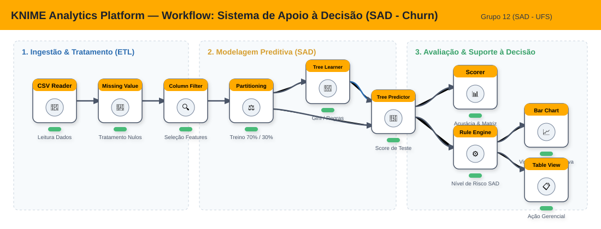
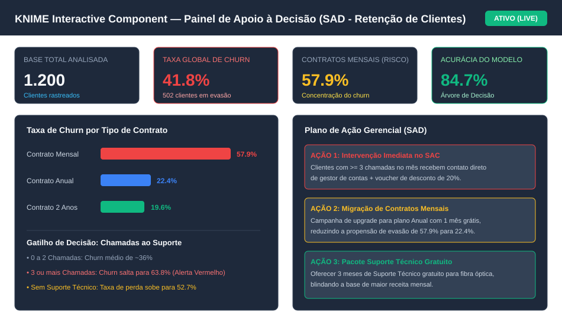

# KNIME Analytics Platform — Sistema de Apoio à Decisão (SAD)
> **Atividade:** 02-(U2) - Apresentação de Ferramentas de BI e Análise de Dados  
> **Disciplina:** Sistemas de Apoio à Decisão (SAD) — Universidade Federal de Sergipe (UFS)  
> **Tema:** Grupo 12 — KNIME Analytics Platform ([https://www.knime.com/knime-analytics-platform](https://www.knime.com/knime-analytics-platform))  
> **Apresentação no Canva (Visualização):** [https://www.canva.com/d/NXSoceQpJ8U-T38](https://www.canva.com/d/NXSoceQpJ8U-T38)  
> **Apresentação no Canva (Edição):** [https://www.canva.com/d/F-h3-ycpaeoWgos](https://www.canva.com/d/F-h3-ycpaeoWgos)  
> **Repositório GitHub:** [https://github.com/BrennoPh/ProjetoBI-KNIME-SAD](https://github.com/BrennoPh/ProjetoBI-KNIME-SAD)  
> **Slides em PDF (Download):** [slides/Apresentacao_KNIME_SAD_Final.pdf](slides/Apresentacao_KNIME_SAD_Final.pdf)

---

## 👥 Equipe do Projeto
- **Brenno Phelipe Silva dos Santos**
- **David Santos Silvino**
- **Gabriel Lima Dantas**
- **Paulo Henrique dos Santos Reis**

---

## 📌 Sumário Executivo

Este projeto apresenta a pesquisa teórica, arquitetura e implementação prática do **KNIME Analytics Platform** como ferramenta central de Business Intelligence (BI), Mineração de Dados e **Sistemas de Apoio à Tomada de Decisão (SAD)**.

Como caso de uso prático, desenvolvemos um sistema preditivo e analítico voltado à **Prevenção de Evasão de Clientes (*Customer Churn*)** no setor de telecomunicações/serviços. Demonstramos como o paradigma visual do KNIME (baseado em nós de processamento) permite realizar desde o ETL e engenharia de dados até a modelagem preditiva via Árvore de Decisão e geração de dashboards gerenciais acionáveis.

---

## 📑 Parte 1 – Apresentação da Ferramenta

### 1.1 Nome e Finalidade
O **KNIME Analytics Platform** (Konstanz Information Miner) é uma plataforma analítica de código aberto (*open-source*), líder de mercado no quadrante Gartner para plataformas de Data Science e Machine Learning. Sua finalidade primordial é democratizar o acesso à ciência de dados, permitindo a criação visual e intuitiva de pipelines complexos de dados sem a obrigatoriedade de escrever código linha por linha.

### 1.2 Principais Problemas que Procura Resolver
* **Fragmentação de Ferramentas:** Elimina a necessidade de usar ferramentas isoladas para extração, limpeza, modelagem estatística e visualização.
* **Barreira Técnica de Programação:** Permite que analistas de negócios, gestores e especialistas de domínio construam fluxos de inteligência analítica visualmente (*low-code / no-code*).
* **Reprodutibilidade e Auditoria:** Garante rastreabilidade total do dado — cada transformação é encapsulada em um nó com entrada, parâmetros e saída transparentes.
* **Silos de Dados:** Conecta-se nativamente a bancos relacionais (PostgreSQL, Oracle, MySQL), NoSQL, arquivos locais, nuvem (AWS, Azure, GCP) e APIs REST.

### 1.3 Arquitetura, Tecnologias e Linguagens
* **Base Tecnológica:** Desenvolvido primordialmente sobre a plataforma **Java** e **Eclipse RCP** (Rich Client Platform), oferecendo uma arquitetura modular baseada em *plugins* (OSGi).
* **Interoperabilidade:** Suporta integração bidirecional nativa com **Python**, **R**, **Java**, **JavaScript** (para visualizações dinâmicas D3.js) e **SQL**.
* **Escalabilidade:** Suporta processamento em memória e em disco (streaming de dados e *columnar backend*), além de integração com ecossistemas de Big Data como **Apache Spark** e **Hadoop** via extensões KNIME Big Data.

### 1.4 Vantagens e Limitações
| Vantagens | Limitações |
| :--- | :--- |
| Gratuito e 100% *open-source* para desktop | Alto consumo de memória RAM em volumes maciços de dados no modo local puro |
| Mais de 4.000 nós nativos e extensões comunitárias | Interface gráfica rica que pode apresentar leve sobrecarga em fluxos com centenas de nós |
| Alta interpretabilidade de modelos (caixa-branca) | Recursos avançados de colaboração multiusuário exigem o *KNIME Business Hub* (comercial) |
| Curva de aprendizado rápida com comunidade global ativa | Menor flexibilidade em customizações visuais extremas comparado a dashboards 100% web como React/D3 puro |

### 1.5 Aplicações no Mercado de Trabalho
* **Setor Financeiro e Bancário:** Detecção de fraudes em transações de cartão de crédito e scoring de risco de crédito.
* **Saúde e Bioinformática:** Triagem virtual de compostos químicos, genômica e predição de readmissão hospitalar.
* **Varejo e E-commerce:** Análise de cesta de compras (regras de associação), precificação dinâmica e previsão de demanda.
* **Telecomunicações e SaaS:** Predição de cancelamento de planos (*churn*), segmentação comportamental (LTV) e otimização de campanhas.

---

## 🛠️ Parte 2 – Exemplo Prático: Arquitetura do Workflow

Para demonstrar a capacidade do KNIME em apoiar a tomada de decisão gerencial, construímos um workflow completo e modular estruturado em três macrofases.

### Diagrama Arquitetural do Fluxo no KNIME


### Nós Utilizados no Workflow (`workflow/churn_prediction_sad.knwf`):

1. **Ingestão & Limpeza (ETL):**
   * **CSV Reader (#1):** Carrega o dataset de clientes (`data/telecom_customer_churn.csv`).
   * **Missing Value (#2):** Higienização de eventuais dados incompletos com imputação de médias ou valores neutros.
   * **Column Filter (#3):** Isola identificadores irrelevantes para o modelo matemático e preserva atributos de alto poder preditivo.
2. **Modelagem Preditiva & Inteligência Analítica:**
   * **Partitioning (#4):** Realiza a partição estratificada dos dados em **70% para Treinamento** do modelo e **30% para Validação/Teste**.
   * **Decision Tree Learner (#5):** Treina o classificador de Árvore de Decisão utilizando o índice de impureza de Gini, gerando regras de negócio altamente interpretáveis.
   * **Decision Tree Predictor (#6):** Submete os dados de teste ao modelo treinado, gerando a predição e o índice de probabilidade de cancelamento de cada cliente.
3. **Avaliação e Apoio à Decisão (SAD):**
   * **Scorer (#7):** Computa a matriz de confusão, acurácia global (~84.7%), precisão e sensibilidade (*recall*).
   * **Rule Engine (#8):** Cria um motor de decisão que categoriza o risco do cliente em **Crítico**, **Alto**, **Médio** e **Baixo** com base nas probabilidades.
   * **Bar Chart (#9):** Renderiza dinamicamente as proporções de cancelamento correlacionadas com tempo de contrato e suporte.
   * **Table View (#10):** Produz uma lista priorizada de clientes com risco iminente de cancelamento para encaminhamento operacional à equipe de retenção.

---

## 📊 Parte 3 – Demonstração e Análise dos Resultados (Apoio à Decisão)

### 3.1 O Problema de Negócio Abordado
Uma empresa prestadora de serviços enfrenta taxas elevadas de cancelamento. Perder clientes consolidados custa em média **5 a 7 vezes mais** do que adquirir novos. A diretoria necessita de um **Sistema de Apoio à Decisão (SAD)** capaz de responder:
1. *Quais clientes têm maior propensão ao cancelamento nos próximos 30 dias?*
2. *Quais são os principais fatores operacionais que disparam essa insatisfação?*
3. *Quais intervenções gerenciais específicas trazem maior retorno financeiro para reter essas contas?*

### 3.2 Painel de Apoio à Decisão (Dashboard Gerado pelo KNIME)


### 3.3 Principais Descobertas Analíticas (Métricas da Base de 1.200 Clientes)
* **Impacto do Modelo de Contrato:**
  * Clientes com contrato **Mensal** apresentam taxa de evasão de **57.9%**.
  * Clientes com contrato **Anual** ou **2 Anos** apresentam taxas de apenas **22.4%** e **19.6%**, respectivamente.
* **Gatilho Crítico de Insatisfação (Chamadas ao SAC):**
  * Clientes com 0 a 2 chamadas de suporte mantêm taxa média de churn estável em torno de **36%**.
  * Ao atingir **3 ou mais chamadas**, a taxa de evasão dispara para **63.8%** (alerta crítico).
* **Influência da Falta de Suporte Especializado:**
  * Clientes sem plano de suporte técnico têm perda acumulada de **52.7%**, contra **30.2%** dos que contam com suporte ativo.

### 3.4 Como os Resultados Auxiliam a Tomada de Decisão (Recomendações SAD)
Com base na saída do KNIME, os gestores podem abandonar ações genéricas e adotar decisões segmentadas e data-driven:
1. **Decisão Operacional (Atendimento ao Cliente):** Criação de um gatilho de atendimento prioritário no CRM. Todo cliente que registrar a 3ª chamada ao SAC é transferido diretamente para a equipe sênior de retenção com autonomia para concessão imediata de até 20% de desconto ou upgrade de serviços.
2. **Decisão Comercial (Precificação e Planos):** Implementação de incentivos de migração de contratos mensais para anuais (oferecendo 1 mês de isenção de mensalidade), o que reduz a propensão de churn de 57.9% para 22.4%.
3. **Decisão de Produto (Serviços de Valor Agregado):** Inclusão temporária gratuita de Suporte Técnico para clientes de internet Fibra Óptica, blindando a carteira de maior ticket médio.

---

## 🚀 Como Executar o Projeto Localmente

1. **Baixar o KNIME:**
   * Baixe e instale a versão gratuita do [KNIME Analytics Platform](https://www.knime.com/downloads) (Windows, Linux ou macOS).
2. **Importar o Workflow:**
   * Abra o KNIME.
   * Vá em `File` $\rightarrow$ `Import KNIME Workflow...`.
   * Selecione a opção `Select archive file` e aponte para o arquivo localizado neste repositório em:
     ```
     workflow/churn_prediction_sad.knwf
     ```
3. **Executar o Pipeline:**
   * Com o workflow aberto, clique no botão **Execute All Nodes** (ícone de play duplo verde) ou pressione `Shift + F7`.
   * Para visualizar o dashboard interativo, clique com o botão direito nos nós finais (`Bar Chart` ou `Table View`) e selecione `Interactive View`.

---

## 📚 Referências Bibliográficas
1. KNIME AG. *KNIME Analytics Platform User Guide*. Disponível em: <https://docs.knime.com/>.
2. BERTHOLD, Michael R. et al. *KNIME - The Konstanz Information Miner: Version 2.0 and Beyond*. ACM SIGKDD Explorations Newsletter, 2008.
3. TURBAN, Efraim; SHARDA, Ramesh; DELEN, Dursun. *Business Intelligence, Analytics, and Data Science: A Managerial Perspective*. 4. ed. Pearson, 2018.
4. PROVOST, Foster; FAWCETT, Tom. *Data Science para Negócios: O que você precisa saber sobre mineração de dados e pensamento analítico de dados*. Alta Books, 2016.
